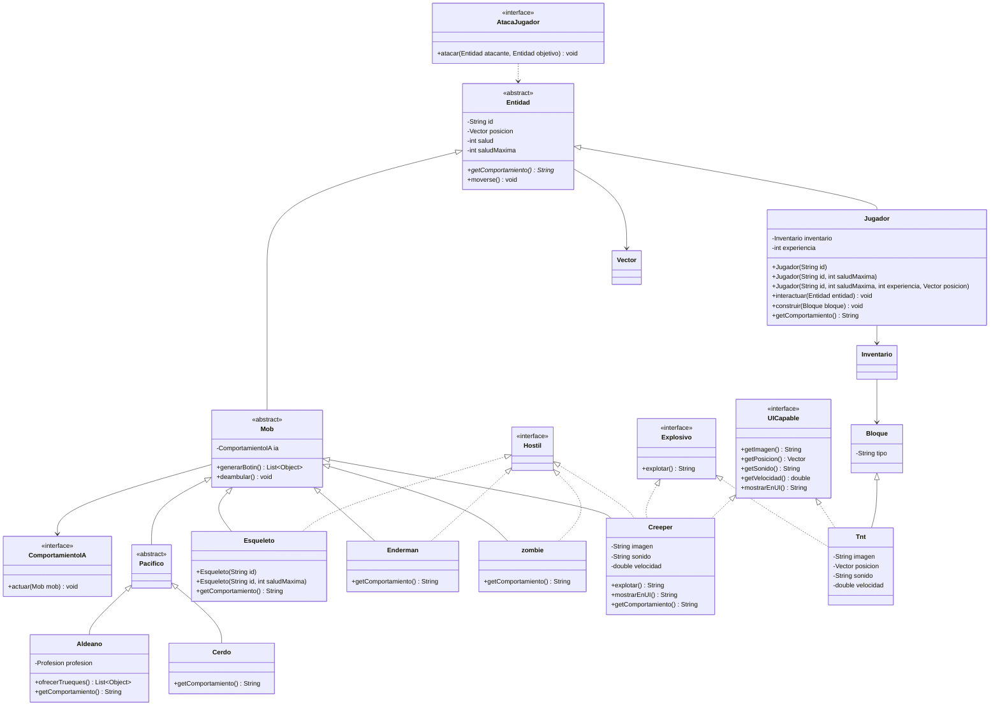
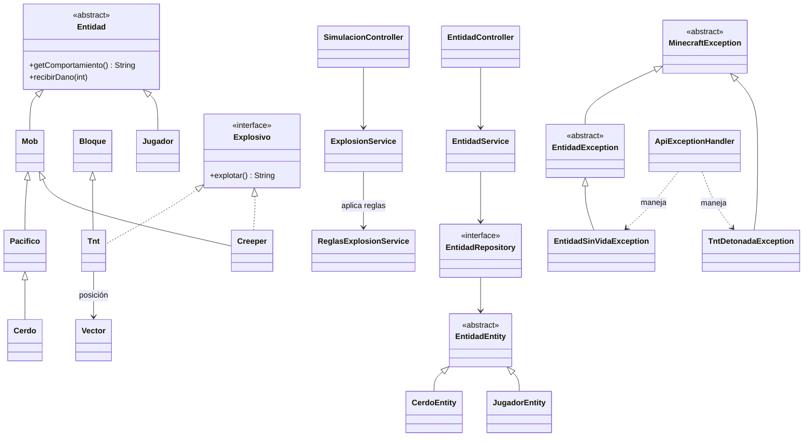

# lfadul-tp-lp3-2026

API REST de ejemplo para representar entidades de Minecraft con Spring Boot,
Maven y Java 21.

## Ejecutar

```bash
cd Minecraft
./mvnw spring-boot:run
```

Endpoints principales:

- `GET /`
- `GET /jugador?id=Alex&saludMaxima=30&experiencia=10&x=1&y=2&z=3`
- `GET /entidades`
- `GET /explosivos`
- `GET /ui-capables`

## Pruebas

```bash
cd Minecraft
./mvnw test
```

## Modelo del dominio



## Licencia y organización

[Apache License 2.0](LICENSE). Trabajo individual de Lucas Fadul, dominio Minecraft.
Java 21 o superior. El Maven Wrapper está en `Minecraft/`.

Siguiendo el [template](https://github.com/alefq/lp3-template-tp/tree/main/src/main/java/py/edu/uc/lp3), bajo `Minecraft/src/main/java/py/edu/uc/lp3/`:

- `Application.java`: arranque de Spring Boot y escaneo de subpaquetes.
- `domain/`: clases del modelo; `domain/exception/`: excepciones del dominio.
- `persistence/`: entidades JPA y repositorios.
- `service/`: servicios de entidades, simulación y clientes HTTP.
- `rest/controller/`: controladores REST y manejo de errores HTTP.
- `rest/dto/` y `rest/response/`: solicitudes y respuestas JSON.

## Sobrecarga y sobreescritura

**Sobrecarga:** `Jugador(String)` usa salud 20 y experiencia 0;
`Jugador(String, int)` permite elegir la salud máxima;
`Jugador(String, int, int, Vector)` recibe también experiencia y posición.
Las firmas delegan con `this` y la hija llama a `super(id, saludMaxima)`.
`Esqueleto` y `Cerdo` tienen constructores con id solo (salud 20 y 10)
y con id más salud. `Vector()` y `Vector(double, double, double)` se conservan.

Además, `ReglasCombateService.atacarConEsqueleto(Entidad)` delega en la
sobrecarga que recibe distancia: sin distancia se asume 0; hasta 16 bloques
inflige 4 de daño y fuera de alcance no hace daño. Una distancia negativa o no
finita se rechaza en el servicio.

**Sobreescritura:** `Entidad.getComportamiento()` es abstracto.
`Esqueleto` y `Cerdo` implementan la misma firma con textos diferentes;
`Jugador` y las otras entidades concretas también la implementan.
`GET /entidades` devuelve `List<Entidad>`: el JSON incluye `comportamiento`
calculado por cada implementación concreta. El controller usa el tipo padre.

## Interfaz compartida entre familias distintas

`Explosivo` representa una capacidad compartida por clases sin un padre común
del dominio. `Creeper` pertenece a la familia `Entidad -> Mob`, mientras que
`Tnt` pertenece a la familia `Bloque`. Las dos implementan la interfaz y pueden
tratarse como `Explosivo`.

La interfaz define `explotar()` con un mensaje `default`. `Tnt` conserva esa
implementación y `Creeper` la reemplaza con `@Override`. El endpoint
`GET /explosivos` crea ambos objetos, los utiliza mediante el tipo de la interfaz
y devuelve el resultado de `explotar()` como JSON.

`UICapable` modela la capacidad de aparecer en una interfaz de usuario. Define
mensajes para obtener imagen, posición, sonido y velocidad, y el mensaje textual
`mostrarEnUI()`. `Creeper` y `Tnt` guardan sus propios datos: el Creeper reemplaza
el mensaje `default` y la TNT lo conserva. `GET /ui-capables` trata los dos objetos
como `UICapable` y devuelve sus propiedades y mensajes en JSON.

## Reglas y errores HTTP

`ReglasCombateService` valida id no vacío, salud máxima positiva, experiencia
no negativa y coordenadas finitas antes de construir el jugador para `GET /jugador`.
Las entradas inválidas responden HTTP 400 con `{"error":"..."}`; un número con
formato incorrecto también recibe HTTP 400 por Spring. Los servicios rechazan daño
y curación negativos y limitan la salud entre 0 y su máximo.

```bash
curl http://localhost:8080/
curl 'http://localhost:8080/jugador?id=Alex&saludMaxima=30&experiencia=10&x=1&y=2&z=3'
curl http://localhost:8080/entidades
curl http://localhost:8080/explosivos
curl http://localhost:8080/ui-capables
curl -i 'http://localhost:8080/jugador?saludMaxima=0'
```

El último pedido debe responder 400. Las pruebas verifican construcción, JSON,
polimorfismo, errores del dominio, alcance del ataque y encapsulamiento.
Las especificaciones de entrega están en [docs/ESPECIFICACIONES-POO08.md](docs/ESPECIFICACIONES-POO08.md).
La asistencia de IA se registra en [BITACORA.md](BITACORA.md).

## Simulación REST de explosiones

Regla de negocio: una TNT causa 8 puntos de daño a una entidad viva a una distancia de hasta 4 bloques, sin reducir la salud por debajo de cero; fuera del radio no causa daño.

`ReglasExplosionService` aplica la regla de daño y calcula la distancia en tres dimensiones con los datos de `Vector` y la entidad persistida conserva la salud resultante.
El controlador delega en `EntidadService`, que recupera el objetivo y guarda la salud resultante mediante Spring Data JPA en H2.

Crear un objetivo y simular la explosión:

```bash
curl -X POST 'http://localhost:8080/api/entidades' \
  -H 'Content-Type: application/json' \
  -d '{"id":"objetivo-tnt","tipo":"CERDO","saludMaxima":10,"posicion":{"x":0,"y":0,"z":0}}'

curl -X POST 'http://localhost:8080/api/entidades/objetivo-tnt/explosiones' \
  -H 'Content-Type: application/json' \
  -d '{"posicion":{"x":3,"y":0,"z":0}}'
```

La segunda petición devuelve `saludAnterior: 10`, `saludActual: 2` y `danoAplicado: 8`.
Se puede consultar el resultado con `GET /api/entidades/objetivo-tnt` o con `SELECT * FROM ENTIDADES` en H2 Console.
La API responde 400 si falta la posición, 404 si el objetivo no existe y 409 si el objetivo ya no tiene vida.
Esta es una simulación simplificada con radio y daño fijos.

## Jerarquía de excepciones de Minecraft

Las excepciones del dominio están en `domain.exception` y forman esta jerarquía:

```text
RuntimeException
└── MinecraftException (abstracta)
    ├── EntidadException (abstracta)
    │   ├── EntidadInvalidaException
    │   ├── EntidadNotFoundException
    │   ├── EntidadConflictException
    │   └── EntidadSinVidaException
    ├── TntDetonadaException
    └── TntNotFoundException
```

`MinecraftException` agrupa los errores del juego y `EntidadException` los relacionados con sus criaturas y jugadores.
El servicio lanza `EntidadInvalidaException` ante datos inválidos (HTTP 400), `EntidadNotFoundException` cuando el objetivo no existe (404) y `EntidadConflictException` cuando el ID ya está registrado (409).
`ReglasExplosionService` lanza `EntidadSinVidaException` si el objetivo está muerto y `TntDetonadaException` si la TNT ya fue detonada; ambas se traducen a HTTP 409.
Cada tipo concreto tiene su propio método `@ExceptionHandler` en `ApiExceptionHandler`, que responde con `{"error":"mensaje"}`.


## POO-08: CRUD, H2 y simulación persistida

Desde la raíz del repositorio, con Java 21 o superior:

```bash
./mvnw spring-boot:run
```

El wrapper de la raíz ejecuta el proyecto `Minecraft`; también se puede ejecutar `cd Minecraft && ./mvnw spring-boot:run`. `GET /` confirma que el servicio está activo y `http://localhost:8080/h2-console` abre la consola H2.

Las propiedades están en `Minecraft/src/main/resources/application.properties`:

- `spring.application.name` asigna el nombre de la aplicación.
- `spring.datasource.url=jdbc:h2:file:${user.home}/.lp3-minecraft/minecraftdb` guarda H2 en un archivo de la carpeta personal del usuario; en la consola hay que reemplazar `${user.home}` por su ruta absoluta.
- `spring.datasource.driver-class-name=org.h2.Driver` selecciona el controlador JDBC de H2.
- `spring.datasource.username=sa` y `spring.datasource.password=` establecen el usuario y una contraseña vacía para desarrollo local.
- `spring.jpa.hibernate.ddl-auto=update` crea o actualiza el esquema según las entidades JPA sin borrar intencionalmente los datos existentes.
- `spring.jpa.open-in-view=false` cierra la sesión de persistencia al salir de la transacción de servicio.
- `spring.h2.console.enabled=true` habilita la consola web de H2 para desarrollo.

En H2 Console, el JDBC URL es `jdbc:h2:file:/ruta/absoluta/al/home/.lp3-minecraft/minecraftdb`, el usuario es `sa` y la contraseña está vacía. Las tablas `ENTIDADES`, `TNTS` y `EXPLOSIONES` se pueden consultar con `SELECT * FROM ENTIDADES;` y consultas equivalentes. El archivo H2 incluido previamente en `Minecraft/data/` es una copia anterior; la aplicación usa la ruta configurada en `application.properties`.

**Regla 1:** una `Tnt` causa 8 de daño a una `Entidad` viva situada a 4 bloques o menos y la salud nunca baja de cero.

**Regla 2:** una `Tnt` se consume al detonar, incluso si el objetivo está fuera del radio, y no puede volver a usarse.

En `POST /api/explosiones`, `ReglasExplosionService` comprueba ambas reglas, calcula la distancia en tres dimensiones y determina el daño. La transacción persiste la salud, el estado de la TNT y el registro de la explosión; si se rechaza una operación no se consume la TNT ni se guarda una explosión.



### Respuestas a «Qué hay que pensar»

- **Recurso y verbo:** `/api/entidades`, `/api/tnts` y `/api/explosiones` nombran recursos; el verbo HTTP indica si se crean, consultan, actualizan o eliminan.
- **Identidad:** el cliente asigna el `id` de entidades y TNT en el JSON; H2 asigna el `id` numérico de cada explosión.
- **Herencia y tablas:** `EntidadEntity` es la base JPA y las hijas usan `SINGLE_TABLE`, con un discriminador `tipo`; el JSON también lleva `tipo` para elegir y reconocer el subtipo. La tabla única evita joins entre tablas de la misma familia y conserva los tipos ya existentes.
- **Interfaz y repositorio:** `EntidadController` depende de `EntidadService`, que usa la interfaz Spring Data `EntidadRepository`; Spring implementa la persistencia, como el protocolo `Explosivo` permite usar distintas implementaciones sin depender de una clase concreta.
- **Protocolo del dominio:** `GET /explosivos` invoca `Explosivo.explotar()` sobre `Creeper` y `Tnt`, de las familias `Entidad` y `Bloque`.
- **Ocultamiento:** `ReglasExplosionService` valida alcance, daño y posición para la explosión; `EntidadService` valida la salud antes de persistirla. Los constructores JPA sin argumentos son protegidos. Las validaciones y reglas de salud y combate se trasladaron a servicios. Los pedidos 08 y 09 de Insomnia muestran que un POST con salud máxima 0 no crea una entidad.
- **PUT y PATCH:** se usa `PUT`, que reemplaza los datos editables; `id`, `tipo` y `saludMaxima` son obligatorios y el tipo no puede cambiar. Si se omiten, `salud` vuelve a la máxima, `posicion` a `(0,0,0)`, `experiencia` a 0 y la profesión de aldeano a `SIN_PROFESION`; no se implementa PATCH.
- **DELETE:** borra físicamente la entidad de la tabla y responde 204; los registros históricos de explosiones conservan los IDs que registraron.
- **Dos reglas y persistencia:** los servicios aplican daño por distancia y consumo de TNT; el recurso `/api/explosiones` registra la simulación y los GET posteriores de la entidad y la TNT muestran ambos estados guardados.
- **Excepciones:** `MinecraftException` y `EntidadException` son bases; hay tipos para datos inválidos, inexistencia, conflicto, entidad sin vida, TNT inexistente y TNT detonada. Son no comprobadas (`RuntimeException`) porque describen errores de dominio que el servicio deja propagar al handler; cada tipo concreto tiene su handler y el JSON lleva `error`.

### Colección de Insomnia

Importar `insomnia/minecraft-poo08.json` mediante **Import → File** en Insomnia. El entorno define `base_url` como `http://localhost:8080`; ejecutar los pedidos numerados en orden: CRUD, POST ilegal y verificación, protocolo, creación de TNT, simulación, consultas del estado, errores y borrado. Copiar el `id` numérico devuelto por la simulación a la variable de entorno `explosion_id` antes del pedido 16. Para repetir el recorrido, usar una base H2 nueva o cambiar los IDs fijos en las peticiones; la TNT detonada no se reutiliza.

## Commit de la solución

### POO-08

[Ver solución POO-08](https://github.com/LucasFadul/lfadul-tp-lp3-2026/commit/bf8efcafbcb9f9ef5ab980ce636536a461a1161b)

### POO-06

[Ver solución POO-06](https://github.com/LucasFadul/lfadul-tp-lp3-2026/commit/a3629c95a2755ec82ca19cbc3b7f3c329f4d8bb7)

Este commit contiene código, pruebas y especificaciones. El commit posterior
únicamente incorpora este enlace de entrega.

### Consulta de objetos externos

El endpoint `GET /api/objetos-externos` consulta con Spring WebClient el listado de `https://api.restful-api.dev/objects`. El campo `data` puede contener distintos atributos o ser `null`. Para cambiar el servidor de origen, configure `api.objetos.base-url` en `Minecraft/src/main/resources/application.properties`.

```bash
curl http://localhost:8080/api/objetos-externos
```

### Documentación de la API

Con la aplicación iniciada, Swagger UI está disponible en [http://localhost:8080/swagger-ui.html](http://localhost:8080/swagger-ui.html). Permite explorar y probar los servicios REST. El contrato OpenAPI también está disponible en [JSON](http://localhost:8080/v3/api-docs) y [YAML](http://localhost:8080/v3/api-docs.yaml).

### Integración con la API del compañero

`GET /api/integracion/esqueletos/{esqueletoId}/jugadores/{jugadorId}/disparo` compara un ataque simulado entre dos entidades locales persistidas con la acción que devuelve la API del compañero. Acepta los parámetros opcionales `danoBase` (4), `velocidad` (1) y `usaArco` (true), usados únicamente en la consulta externa. La distancia entre posiciones locales se redondea hacia arriba para enviarla como número entero a esa API. El daño local utiliza la regla propia del proyecto; la acción externa se informa por separado. La simulación no modifica las entidades.

La dirección del compañero se configura con `api.companero.base-url` en `application.properties`. Su servidor debe estar disponible desde la aplicación para que la consulta funcione. El endpoint también está disponible en Swagger UI, en **Integración con compañero**.

### POO-09: grupo y trabajo pendiente

- A1: Lucas Fadul, [lfadul-tp-lp3-2026](https://github.com/LucasFadul/lfadul-tp-lp3-2026); OpenAPI local: `http://localhost:8080/v3/api-docs`.
- A2: MatRF04, [mr-taller-git-2026](https://github.com/MatRF04/mr-taller-git-2026), commit consultado `727c53064c081ecfad8fdc4cc597d14a485150ab`. Esa copia local no publicó `/v3/api-docs` (404); el servicio visto por Hamachi sí publicó OpenAPI el 23/11/2026 en `http://25.28.15.25:8080/v3/api-docs`. Falta confirmar su commit.
- A3: SaDez7, [sb-taller-git-2026](https://github.com/SaDez7/sb-taller-git-2026), commit consultado `1853e5226ce5aea60574fa0ebb4d8f8bbfb33aae`. OpenAPI local en `http://localhost:8082/v3/api-docs`. Su regla de explosión reduce el daño con la distancia y destruye bloques alcanzados; ver [sus reglas](https://github.com/SaDez7/sb-taller-git-2026#las-dos-reglas-de-negocio).

Se prepararon clientes de solo lectura para `GET /entidades/creepers/listos` de A2 y `GET /entidades/vivos` de A3. Sus URLs se configuran con `API_A2_BASE_URL` y `API_A3_BASE_URL`, o con `api.a2.base-url` y `api.a3.base-url`. La consulta de A2 es provisional: la ruta y la regla aparecen en el OpenAPI observado en clase y en el README del commit consultado, pero ese commit no publicó OpenAPI al ejecutarlo. `POST /api/jugadas` usa estas listas como verificaciones previas y guarda una explosión y una jugada locales si ambos participantes aparecen. La ausencia se interpreta en A1 como un rechazo atribuido a la lista de A2 o A3: las APIs devuelven listas HTTP 200 y no un rechazo explícito. Falta confirmar con la cátedra o compañeros si estas verificaciones satisfacen las reglas de explosión exigidas; no se pretende que las simulaciones remotas de explosión se hayan ejecutado.

La colección `insomnia/minecraft-poo09.json` incluye preparación local, consultas, ausencia en A2, ausencia en A3, caso feliz y consulta de jugada. Las variables de ids deben ajustarse a las entidades disponibles. Las dos ausencias reales se comprobaron por Hamachi y el caso feliz se observó con ambas APIs reales el 23/11/2026 (HTTP 201, jugada 1 y explosión 5). Para repetirlo hacen falta IDs presentes y una TNT local sin detonar.

### Estado de la corrección POO-08 (21/24)

- **Base H2 en Git:** se dejó de seguir `Minecraft/data/minecraftdb.mv.db` sin borrar la copia local y se excluyeron `*.mv.db` y `*.trace.db` con `.gitignore`. La eliminación del índice y los cambios aún deben incluirse en el commit de entrega.
- **Capas y validaciones:** se retiraron excepciones de las entidades del dominio y persistencia. `ReglasCombateService` valida el jugador y aplica salud/combate; `ReglasExplosionService` valida coordenadas y calcula daño de TNT; `EntidadService` valida el CRUD y `ExplosionService` coordina la transacción. Los mensajes de comportamiento y capacidades de ejemplos anteriores permanecen en el modelo para conservar su demostración de interfaces y polimorfismo.
- **Documentación:** se actualizaron paquetes, enlace de especificaciones y jerarquía de excepciones; los ejemplos de combate ahora apuntan al servicio.

### Arranque local para POO-09

Usar copias independientes y versiones confirmadas de los dos repositorios. La revisión actual usó los commits indicados arriba; deben actualizarse cuando los compañeros confirmen sus versiones de entrega. En terminales separadas:

```bash
# Desde la raíz de cada copia:
# A1 - este repositorio
./mvnw spring-boot:run

# A2 - copia de MatRF04
./mvnw spring-boot:run -Dspring-boot.run.arguments="--server.port=8081"

# A3 - copia de SaDez7
./mvnw spring-boot:run -Dspring-boot.run.arguments="--server.port=8082"
```

A1 usa por defecto `http://localhost:8081` para A2 y `http://localhost:8082` para A3. Una aplicación por puerto; cada copia mantiene su propia base. La colección consulta los OpenAPI, las listas y el endpoint de jugadas. A2 y A3 devuelven listas; A1 interpreta la ausencia como rechazo atribuido. Debe confirmarse la adecuación de estas reglas al enunciado y comprobar el caso feliz con las dos APIs reales.

### Jugada cruzada provisional

`POST /api/jugadas` recibe `creeperA2` (id numérico en A2), `jugadorA3` (id en A3), `tntId` y `objetivoId` (ambos en A1). Consulta primero `GET /entidades/creepers/listos` de A2; si el id no aparece, A1 devuelve 422 con `origen: A2`. Luego consulta `GET /entidades/vivos` de A3; si el jugador no aparece, A1 devuelve 422 con `origen: A3`. El orden evita consultar A3 si falla la primera comprobación. Una falla de conexión devuelve 502.

Si ambas listas contienen los participantes, una transacción local ejecuta la simulación de TNT y guarda `jugadas_cruzadas` con el id de la explosión. `GET /api/jugadas/{id}` consulta el registro y `GET /api/explosiones/{explosionId}` muestra el resultado. Los identificadores externos y locales son independientes: la operación no sincroniza entidades entre las bases. Los servicios de compañeros solo se consultan con GET.

Para repetir: crear en A1 un objetivo y una TNT, elegir ids de las listas reales y ejecutar los pedidos 05 a 08 de Insomnia. Las simulaciones remotas de explosión **no** se invocan; la aceptación o rechazo es inferencia de A1 a partir de las listas. La cátedra debe confirmar si esto cumple el requisito de validación de reglas de explosión y rechazo explícito.

### Validación de explosión sin cambios

`POST /api/entidades/{id}/explosiones/validar` recibe el mismo cuerpo de posición que la simulación sobre entidad. Calcula el daño de TNT de Lucas (radio 4, hasta 8 de daño), pero no cambia la salud ni guarda una explosión ni consume una TNT. Responde 200 con `saludAnterior`, `saludActual` simulada y `danoAplicado`; 400 si falta o es inválida la posición, 404 si no existe la entidad y 409 si no tiene vida. La operación valida una explosión hipotética: no verifica ni consume una TNT persistida.

```json
{ "posicion": { "x": 0, "y": 0, "z": 0 } }
```

### Guía para coordinar y probar

Ver [docs/GUIA-COORDINACION-POO09.md](docs/GUIA-COORDINACION-POO09.md) para preparar objetivos en cada proyecto, entender qué bases cambian y ejecutar las pruebas del escenario provisional.
