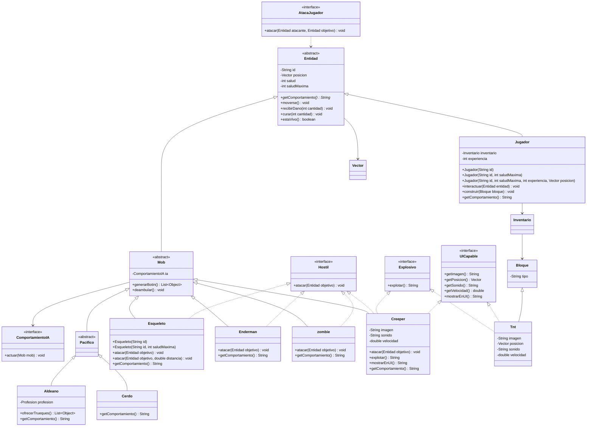
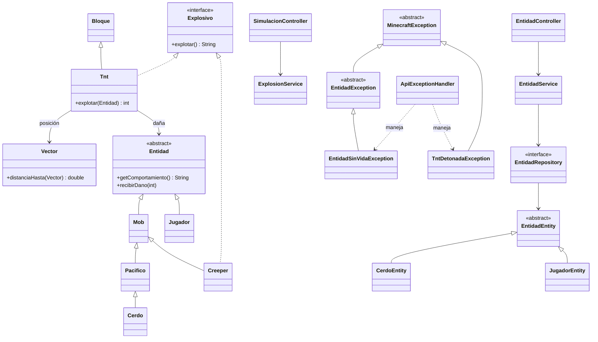

# lfadul-tp-lp3-2026

API REST de ejemplo para representar entidades de Minecraft con Spring Boot,
Maven y Java 21.

## Ejecutar

```bash
cd Minecraft
./mvnw spring-boot:run
```

Endpoints principales:

- `GET /`
- `GET /jugador?id=Alex&saludMaxima=30&experiencia=10&x=1&y=2&z=3`
- `GET /entidades`
- `GET /explosivos`
- `GET /ui-capables`

## Pruebas

```bash
cd Minecraft
./mvnw test
```

## Modelo del dominio



## Licencia y organización

[Apache License 2.0](LICENSE). Trabajo individual de Lucas Fadul, dominio Minecraft.
Java 21 o superior. El Maven Wrapper está en `Minecraft/`.

Siguiendo el [template](https://github.com/alefq/lp3-template-tp/tree/main/src/main/java/py/edu/uc/lp3), bajo `Minecraft/src/main/java/py/edu/uc/lp3/`:

- `Application.java`: arranque de Spring Boot y escaneo de subpaquetes.
- `domain/`: todas las clases del modelo y sus reglas.
- `rest/controller/`: controllers de inicio, jugadores y explosivos.
- `rest/response/`: respuestas JSON específicas de los servicios REST.

## Sobrecarga y sobreescritura

**Sobrecarga:** `Jugador(String)` usa salud 20 y experiencia 0;
`Jugador(String, int)` permite elegir la salud máxima;
`Jugador(String, int, int, Vector)` recibe también experiencia y posición.
Las firmas delegan con `this` y la hija llama a `super(id, saludMaxima)`.
`Esqueleto` y `Cerdo` tienen constructores con id solo (salud 20 y 10)
y con id más salud. `Vector()` y `Vector(double, double, double)` se conservan.

Además, `Esqueleto.atacar(Entidad)` delega en `atacar(Entidad, double)`:
sin distancia se asume 0; con distancia hasta 16 bloques inflige 4 de daño,
y fuera de alcance no hace daño. Una distancia negativa o no finita se rechaza.
Son firmas distintas de la misma acción en la misma clase.

**Sobreescritura:** `Entidad.getComportamiento()` es abstracto.
`Esqueleto` y `Cerdo` implementan la misma firma con textos diferentes;
`Jugador` y las otras entidades concretas también la implementan.
`GET /entidades` devuelve `List<Entidad>`: el JSON incluye `comportamiento`
calculado por cada implementación concreta. El controller usa el tipo padre.

## Interfaz compartida entre familias distintas

`Explosivo` representa una capacidad compartida por clases sin un padre común
del dominio. `Creeper` pertenece a la familia `Entidad -> Mob`, mientras que
`Tnt` pertenece a la familia `Bloque`. Las dos implementan la interfaz y pueden
tratarse como `Explosivo`.

La interfaz define `explotar()` con un mensaje `default`. `Tnt` conserva esa
implementación y `Creeper` la reemplaza con `@Override`. El endpoint
`GET /explosivos` crea ambos objetos, los utiliza mediante el tipo de la interfaz
y devuelve el resultado de `explotar()` como JSON.

`UICapable` modela la capacidad de aparecer en una interfaz de usuario. Define
mensajes para obtener imagen, posición, sonido y velocidad, y el mensaje textual
`mostrarEnUI()`. `Creeper` y `Tnt` guardan sus propios datos: el Creeper reemplaza
el mensaje `default` y la TNT lo conserva. `GET /ui-capables` trata los dos objetos
como `UICapable` y devuelve sus propiedades y mensajes en JSON.

## Reglas y errores HTTP

El constructor valida id no vacío, salud máxima positiva, experiencia no negativa
y coordenadas finitas. El controller construye una instancia nueva con los valores
URL; no asigna vida a mano. El dominio rechaza valores inválidos y el controller
responde HTTP 400 con `{"error":"..."}`. Un número con formato incorrecto también
recibe HTTP 400 por Spring. La salud se mantiene entre 0 y su máximo; daño y
curación negativos se rechazan, y una curación grande no desborda.

```bash
curl http://localhost:8080/
curl 'http://localhost:8080/jugador?id=Alex&saludMaxima=30&experiencia=10&x=1&y=2&z=3'
curl http://localhost:8080/entidades
curl http://localhost:8080/explosivos
curl http://localhost:8080/ui-capables
curl -i 'http://localhost:8080/jugador?saludMaxima=0'
```

El último pedido debe responder 400. Las pruebas verifican construcción, JSON,
polimorfismo, errores del dominio, alcance del ataque y encapsulamiento.
Las especificaciones de entrega están en [docs/ESPECIFICACIONES.md](docs/ESPECIFICACIONES.md).
La asistencia de IA se registra en [BITACORA.md](BITACORA.md).

## Simulación REST de explosiones

Regla de negocio: una TNT causa 8 puntos de daño a una entidad viva a una distancia de hasta 4 bloques, sin reducir la salud por debajo de cero; fuera del radio no causa daño.

Participan tres clases del modelo: `Tnt` aplica la explosión, `Vector` calcula la distancia en tres dimensiones y `Entidad` recibe el daño.
El controlador delega en `EntidadService`, que recupera el objetivo y guarda la salud resultante mediante Spring Data JPA en H2.

Crear un objetivo y simular la explosión:

```bash
curl -X POST 'http://localhost:8080/api/entidades' \
  -H 'Content-Type: application/json' \
  -d '{"id":"objetivo-tnt","tipo":"CERDO","saludMaxima":10,"posicion":{"x":0,"y":0,"z":0}}'

curl -X POST 'http://localhost:8080/api/entidades/objetivo-tnt/explosiones' \
  -H 'Content-Type: application/json' \
  -d '{"posicion":{"x":3,"y":0,"z":0}}'
```

La segunda petición devuelve `saludAnterior: 10`, `saludActual: 2` y `danoAplicado: 8`.
Se puede consultar el resultado con `GET /api/entidades/objetivo-tnt` o con `SELECT * FROM ENTIDADES` en H2 Console.
La API responde 400 si falta la posición, 404 si el objetivo no existe y 409 si el objetivo ya no tiene vida.
Esta es una simulación simplificada con radio y daño fijos.

## Jerarquía de excepciones de Minecraft

Las excepciones del dominio están en `domain.exception` y forman esta jerarquía:

```text
RuntimeException
└── MinecraftException (abstracta)
    └── EntidadException (abstracta)
        ├── EntidadInvalidaException
        ├── EntidadNotFoundException
        ├── EntidadConflictException
        └── EntidadSinVidaException
```

`MinecraftException` agrupa los errores del juego y `EntidadException` los relacionados con sus criaturas y jugadores.
El servicio lanza `EntidadInvalidaException` ante datos inválidos (HTTP 400), `EntidadNotFoundException` cuando el objetivo no existe (404) y `EntidadConflictException` cuando el ID ya está registrado (409).
La clase `Tnt` lanza `EntidadSinVidaException` si el objetivo está muerto (409), por lo que la regla se cumple también al usar el modelo sin REST.
Cada tipo concreto tiene su propio método `@ExceptionHandler` en `ApiExceptionHandler`, que responde con `{"error":"mensaje"}`.


## POO-08: CRUD, H2 y simulación persistida

Desde la raíz del repositorio, con Java 21 o superior:

```bash
./mvnw spring-boot:run
```

El wrapper de la raíz ejecuta el proyecto `Minecraft`; también se puede ejecutar `cd Minecraft && ./mvnw spring-boot:run`. `GET /` confirma que el servicio está activo y `http://localhost:8080/h2-console` abre la consola H2.

Las propiedades están en `Minecraft/src/main/resources/application.properties`:

- `spring.application.name` asigna el nombre de la aplicación.
- `spring.datasource.url=jdbc:h2:file:${user.home}/.lp3-minecraft/minecraftdb` guarda H2 en un archivo de la carpeta personal del usuario; en la consola hay que reemplazar `${user.home}` por su ruta absoluta.
- `spring.datasource.driver-class-name=org.h2.Driver` selecciona el controlador JDBC de H2.
- `spring.datasource.username=sa` y `spring.datasource.password=` establecen el usuario y una contraseña vacía para desarrollo local.
- `spring.jpa.hibernate.ddl-auto=update` crea o actualiza el esquema según las entidades JPA sin borrar intencionalmente los datos existentes.
- `spring.jpa.open-in-view=false` cierra la sesión de persistencia al salir de la transacción de servicio.
- `spring.h2.console.enabled=true` habilita la consola web de H2 para desarrollo.

En H2 Console, el JDBC URL es `jdbc:h2:file:/ruta/absoluta/al/home/.lp3-minecraft/minecraftdb`, el usuario es `sa` y la contraseña está vacía. Las tablas `ENTIDADES`, `TNTS` y `EXPLOSIONES` se pueden consultar con `SELECT * FROM ENTIDADES;` y consultas equivalentes. El archivo H2 incluido previamente en `Minecraft/data/` es una copia anterior; la aplicación usa la ruta configurada en `application.properties`.

**Regla 1:** una `Tnt` causa 8 de daño a una `Entidad` viva situada a 4 bloques o menos y la salud nunca baja de cero.

**Regla 2:** una `Tnt` se consume al detonar, incluso si el objetivo está fuera del radio, y no puede volver a usarse.

En `POST /api/explosiones`, `Tnt`, `Entidad` y `Vector` colaboran: la TNT comprueba ambas reglas, la distancia se calcula en tres dimensiones y la entidad recibe el daño. La transacción persiste la salud, el estado de la TNT y el registro de la explosión; si se rechaza una operación no se consume la TNT ni se guarda una explosión.



### Respuestas a «Qué hay que pensar»

- **Recurso y verbo:** `/api/entidades`, `/api/tnts` y `/api/explosiones` nombran recursos; el verbo HTTP indica si se crean, consultan, actualizan o eliminan.
- **Identidad:** el cliente asigna el `id` de entidades y TNT en el JSON; H2 asigna el `id` numérico de cada explosión.
- **Herencia y tablas:** `EntidadEntity` es la base JPA y las hijas usan `SINGLE_TABLE`, con un discriminador `tipo`; el JSON también lleva `tipo` para elegir y reconocer el subtipo. La tabla única evita joins entre tablas de la misma familia y conserva los tipos ya existentes.
- **Interfaz y repositorio:** `EntidadController` depende de `EntidadService`, que usa la interfaz Spring Data `EntidadRepository`; Spring implementa la persistencia, como el protocolo `Explosivo` permite usar distintas implementaciones sin depender de una clase concreta.
- **Protocolo del dominio:** `GET /explosivos` invoca `Explosivo.explotar()` sobre `Creeper` y `Tnt`, de las familias `Entidad` y `Bloque`.
- **Ocultamiento:** `Tnt`, `Entidad` y `Vector` comprueban alcance, daño, vida y coordenadas; los constructores JPA sin argumentos son protegidos, y la entidad persistida valida su salud. Los pedidos 08 y 09 de Insomnia muestran que un POST con salud máxima 0 no crea una entidad.
- **PUT y PATCH:** se usa `PUT`, que reemplaza los datos editables; `id`, `tipo` y `saludMaxima` son obligatorios y el tipo no puede cambiar. Si se omiten, `salud` vuelve a la máxima, `posicion` a `(0,0,0)`, `experiencia` a 0 y la profesión de aldeano a `SIN_PROFESION`; no se implementa PATCH.
- **DELETE:** borra físicamente la entidad de la tabla y responde 204; los registros históricos de explosiones conservan los IDs que registraron.
- **Dos reglas y persistencia:** daño por distancia y consumo de TNT son acciones del dominio; el recurso `/api/explosiones` registra la simulación y los GET posteriores de la entidad y la TNT muestran ambos estados guardados.
- **Excepciones:** `MinecraftException` y `EntidadException` son bases; hay tipos para datos inválidos, inexistencia, conflicto, entidad sin vida, TNT inexistente y TNT detonada. Son no comprobadas (`RuntimeException`) porque describen errores de dominio que el servicio deja propagar al handler; cada tipo concreto tiene su handler y el JSON lleva `error`.

### Colección de Insomnia

Importar `insomnia/minecraft-poo08.json` mediante **Import → File** en Insomnia. El entorno define `base_url` como `http://localhost:8080`; ejecutar los pedidos numerados en orden: CRUD, POST ilegal y verificación, protocolo, creación de TNT, simulación, consultas del estado, errores y borrado. Copiar el `id` numérico devuelto por la simulación a la variable de entorno `explosion_id` antes del pedido 16. Para repetir el recorrido, usar una base H2 nueva o cambiar los IDs fijos en las peticiones; la TNT detonada no se reutiliza.

## Commit de la solución

### POO-08

[Ver solución POO-08](https://github.com/LucasFadul/lfadul-tp-lp3-2026/commit/bf8efcafbcb9f9ef5ab980ce636536a461a1161b)

### POO-06

[Ver solución POO-06](https://github.com/LucasFadul/lfadul-tp-lp3-2026/commit/a3629c95a2755ec82ca19cbc3b7f3c329f4d8bb7)

Este commit contiene código, pruebas y especificaciones. El commit posterior
únicamente incorpora este enlace de entrega.
